# Gemelo Digital · Control de Acceso de una Planta Maquiladora

Modelo lógico en **SWI-Prolog** del sistema de control de acceso de una planta maquiladora en Tijuana. El gemelo **decide** si una tarjeta puede abrir una puerta, **explica** por qué, y **desempata** cuando dos reglas válidas chocan. Tiene su propio servidor web y una interfaz diseñada en Google Stitch.

| | |
|---|---|
| **Estudiante** | Garcia Caro Carlos Alejandro |
| **Materia** | Programación Lógica y Funcional — TecNM Campus Tijuana |
| **Proyecto** | #7 Control de acceso — Fase 2: Gemelo digital en Prolog |
| **Tecnología** | SWI-Prolog 11 · plunit · HTTP de SWI-Prolog · HTML/CSS/JS |
| **Pruebas** | 40 pruebas plunit, todas en verde |

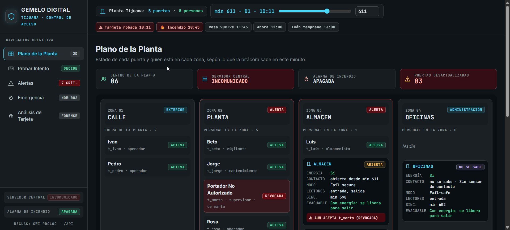

---

## Índice

1. [Qué es este proyecto](#1-qué-es-este-proyecto)
2. [Cómo correrlo](#2-cómo-correrlo)
3. [Estructura del repositorio](#3-estructura-del-repositorio)
4. [Arquitectura](#4-arquitectura)
5. [El modelo lógico](#5-el-modelo-lógico)
6. [Las cinco situaciones](#6-las-cinco-situaciones)
7. [Las cinco preguntas con las mismas reglas](#7-las-cinco-preguntas-con-las-mismas-reglas)
8. [Interfaz](#8-interfaz)
9. [API](#9-api)
10. [Pruebas](#10-pruebas)
11. [Supuestos](#11-supuestos)
12. [Hallazgos del gemelo](#12-hallazgos-del-gemelo)
13. [Erlang y Prolog: qué va en cada lado](#13-erlang-y-prolog-qué-va-en-cada-lado)
14. [Lo que se logró](#14-lo-que-se-logró)
15. [Tecnologías](#15-tecnologías)
16. [Incidencias durante el desarrollo](#16-incidencias-durante-el-desarrollo)
17. [Referencias](#17-referencias)

---

## 1. Qué es este proyecto

El proyecto #7 de la clase tiene dos fases:

- **Fase 1 (Erlang/OTP):** simular el control de acceso: 40 puertas concurrentes, 2,000 personas, picos de 150 lecturas por minuto, servidor caído 30 minutos y una tarjeta robada usada 3 veces en 1 minuto. Esa simulación responde **«¿qué pasó?»** ([enunciado](docs/PROBLEMA_ORIGINAL_ERLANG.md)).
- **Fase 2 (este repositorio):** el **gemelo digital** en Prolog. Responde **«¿debía pasar, y por qué?»** y **«¿a quién le fallamos cuando dos reglas chocan?»** ([enunciado](docs/PROBLEMA.md) · [contexto y criterios](docs/CONTEXTO_AGENTES.md)).

Un gemelo digital no es una base de datos: es un modelo que **conoce y deduce**. Los hechos dicen cosas simples (el rol de alguien, cuándo se sincronizó una puerta, qué marcó un sensor) y las reglas deducen lo que nadie escribió: quién puede pasar, quién está dentro, qué puerta fue forzada o quién se queda sin salida en un incendio.

La planta del modelo es una versión reducida: **5 puertas, 8 personas y 4 zonas** (calle, planta, almacén y oficinas), con las cinco situaciones del enunciado ocurriendo en una sola línea de tiempo.

## 2. Cómo correrlo

### Requisitos

- **SWI-Prolog 9 o superior.**
  - Windows: `winget install --id=SWI-Prolog.SWI-Prolog -e`
  - Ubuntu / WSL: `sudo apt-add-repository ppa:swi-prolog/stable && sudo apt update && sudo apt install swi-prolog`
  - macOS: `brew install swi-prolog`
- Un navegador (Chrome, Edge o Firefox). No se necesita internet.

### Pruebas

```bash
cd gemelo
swipl -g run_tests -t halt tests/reglas_tests.pl
```

Resultado esperado: `% All 40 tests passed`.

### Servidor e interfaz

```bash
cd gemelo
swipl servidor.pl          # o: swipl servidor.pl 9000 para otro puerto
```

Abre **http://localhost:8080**. La consola debe quedarse abierta. Para detener el servidor escribe `halt.`.

> **Windows:** si PowerShell no reconoce `swipl`, usa la ruta completa:
> `& "C:\Program Files\swipl\bin\swipl.exe" servidor.pl`

| Pruebas | Servidor |
|---|---|
| 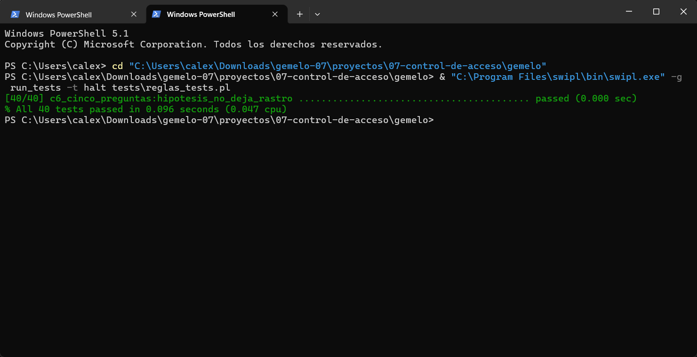 | 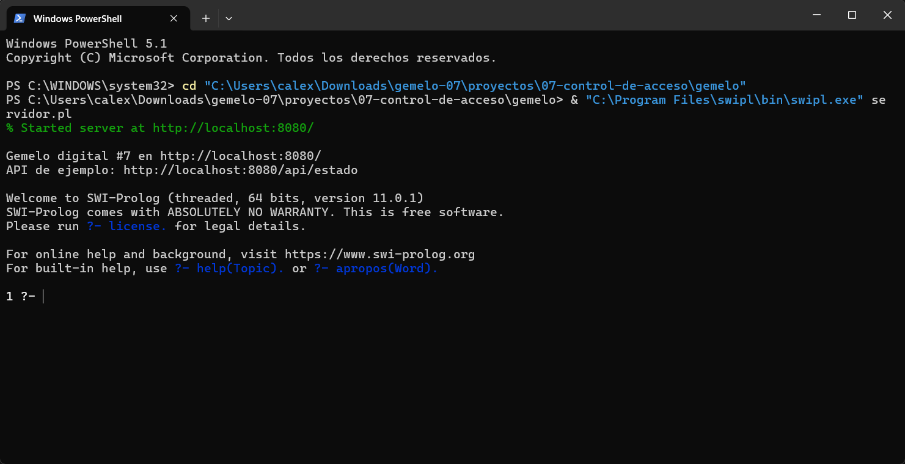 |

## 3. Estructura del repositorio

```text
gemelo-digital-control-acceso/
├── README.md                     ← este documento
├── gemelo/                       ← el gemelo digital (todo en SWI-Prolog)
│   ├── hechos.pl                 estado de la planta (155 hechos)
│   ├── reglas.pl                 reglas: decide/3, situacion/3, tres valores, hipótesis…
│   ├── frases.pl                 traduce las deducciones a frases en español
│   ├── servidor.pl               servidor HTTP + API JSON
│   ├── tests/reglas_tests.pl     40 pruebas plunit
│   ├── web/index.html            interfaz (solo consulta /api)
│   └── README.md                 detalle técnico, supuestos y cifras
├── design/                       ← export de Google Stitch (escritorio y celular)
└── docs/
    ├── PROBLEMA.md               enunciado del gemelo (5 situaciones)
    ├── CONTEXTO_AGENTES.md       contexto, contrato y criterios de aceptación
    ├── PROBLEMA_ORIGINAL_ERLANG.md   enunciado de la fase 1
    └── capturas/                 evidencias de ejecución
```

## 4. Arquitectura

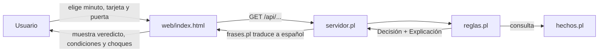

| Capa | Archivo | Responsabilidad |
|---|---|---|
| Estado | `hechos.pl` | Lo que es verdad: personas, turnos, permisos, puertas, credenciales, sincronizaciones, bitácora y sensores |
| Razonamiento | `reglas.pl` | Lo que se deduce: decisiones, posiciones, situaciones, rutas de evacuación y anomalías |
| Presentación | `frases.pl` | Traduce términos de Prolog a español; no decide nada |
| Servicio | `servidor.pl` | API JSON bajo `/api/` y archivos estáticos de `web/` |
| Interfaz | `web/index.html` | Solo consulta y muestra |
| Verificación | `tests/reglas_tests.pl` | 40 pruebas plunit |

**Regla de oro:** ninguna regla del dominio vive en JavaScript. Si mañana cambia una política, se cambia en Prolog y la interfaz la muestra sin tocarla.

## 5. El modelo lógico

### 5.1 Hechos

Se respeta el vocabulario base del enunciado: `persona/3`, `turno/3`, `permiso/3`, `puerta/5`, `credencial/4`, `sincronizada/2`, `evento/6`, `lectura/4`, `rango/3`, `excepcion/6` y `traslado/3`. Además se agregaron predicados propios: `lector/3`, `sensor/2`, `horario_zona/3`, `facultad/2`, `acceso_general/1`, `servidor_caido/2`, `retraso_lector/5`, `politica_duda/2` y `umbral/2`.

El tiempo es un **hecho** (`ahora(720)` = 12:00) y no el reloj del sistema, así que las respuestas siempre se pueden repetir.

### 5.2 Lógica de tres valores

Cada condición vale **`si`**, **`no`** o **`no_se_sabe`**. Al combinarlas:

| Condiciones | Decisión |
|---|---|
| Alguna vale `no` | **negar** |
| Ninguna `no`, alguna `no_se_sabe` | lo que diga la **política ante la duda** de esa puerta, y se alerta |
| Todas `si` | **abrir**, o **abrir y alertar** si el servidor sabe algo que la puerta no |

Así el gemelo nunca convierte una duda en un sí o un no silencioso.

### 5.3 El contrato

```prolog
decide(+Intento, -Decision, -Explicacion)
%   Intento     = intento(Tarjeta, Puerta, Lector, Minuto)
%   Decision    = abrir | negar | abrir_y_alertar | negar_y_alertar
%   Explicacion = [ c(Condicion, si|no|no_se_sabe, Detalle),
%                   choque(ReglaA, ReglaB, gana(R), se_le_falla(Quien)),
%                   alerta(AQuien, Que), politica(Puerta, Decision) ]

situacion(?Entidad, ?Situacion, -Evidencia)
%   consultable en cualquier dirección:
%   ?- situacion(Q, dentro(almacen), _).          % ¿quién está en el almacén?
%   ?- situacion(puerta(almacen), S, Ev).         % ¿qué le pasó a esta puerta?
```

`decide/3` revisa cuatro condiciones en cada intento: **energía**, **credencial según la puerta**, **derecho** (rol, turno, horario y excepción con facultad) y **anti-passback**.

Hay otros predicados clave:
- `auditar/3` repite la decisión con todo lo que llegó después.
- `con_hipotesis/2` cambia hechos temporalmente y luego los restaura.
- `que_falta/2` busca qué hecho voltearía una negación y lo verifica.

## 6. Las cinco situaciones

### Situación 1 — ¿Le toca entrar a esta hora?

**La historia:** Iván es operador del turno vespertino (14:00) y llega a las 13:00, porque Marta, la supervisora, le pidió cubrir una vacante. Además, un visitante con tarjeta activa intenta entrar a oficinas.

**Qué deduce el gemelo:** el derecho vigente, encadenando rol, turno, zona, estado de la tarjeta, la excepción y **si quien la dio tenía facultad**.
- Iván a las 13:00 → **ABRIR**: la regla de turno lo niega, pero gana la excepción de Marta. La explicación nombra el choque.
- A las 11:40 → **NEGAR**: la excepción solo vale de 12:40 a 15:00.
- Visitante en oficinas → **NEGAR**. Al preguntar qué faltaría, el gemelo propone una excepción de **Beto** (vigilante) y **no** una de Marta, porque una supervisora no tiene facultad en oficinas.

| Iván a las 13:00 | Reglas en choque | Visitante: ¿qué tendría que cambiar? |
|---|---|---|
| 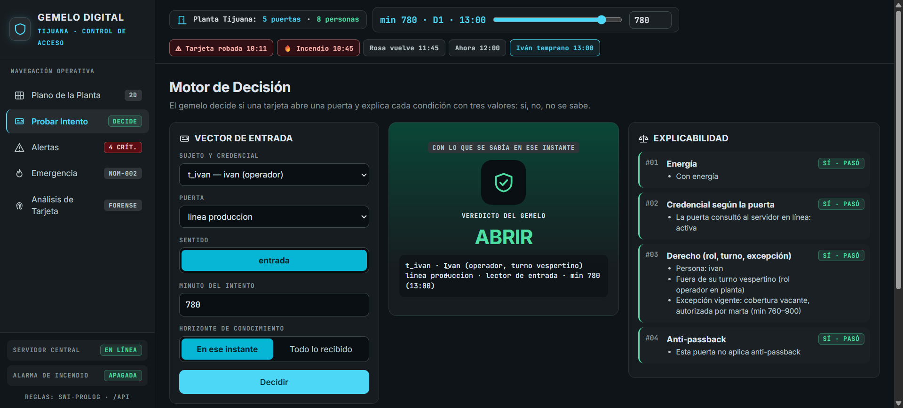 | 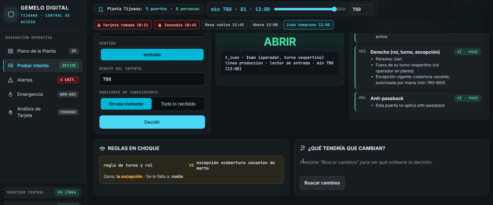 | 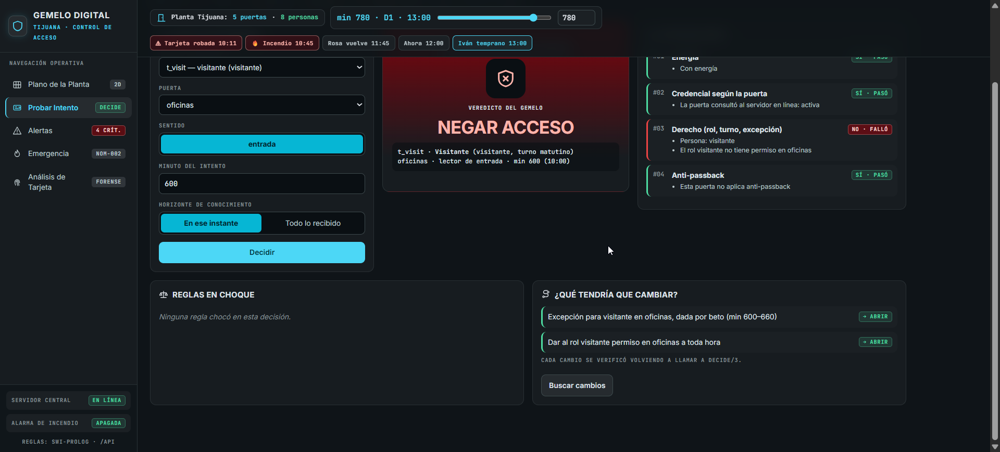 |

### Situación 2 — Entró, salió y el sistema no se enteró

**La historia:** Rosa sale a las 11:40 por su chamarra, pero el lector de salida se atrasa y su evento llega hasta las 11:52. A las 11:45 vuelve a entrar. En otro caso, alguien usa la tarjeta de Luis, que sigue dentro.

**Qué deduce el gemelo:** quién está dentro, ordenando por el **reloj del lector** y no por la hora de llegada, y separando **«no ha salido»** de **«no me he enterado de que salió»**.
- Rosa, en tiempo real → **ABRIR Y ALERTAR**: el anti-passback vale **no se sabe** porque el lector de salida no ha reportado desde las 11:30, y decide la política.
- Rosa, con todo lo recibido → **ABRIR**: salió a las 11:40.
- La tarjeta de Luis → **NEGAR**: Luis sigue dentro y el lector sí está al corriente.
- Si dos eventos opuestos caen dentro del desfase tolerado (2 min) → **orden incierto**, nunca un sí o un no silencioso.

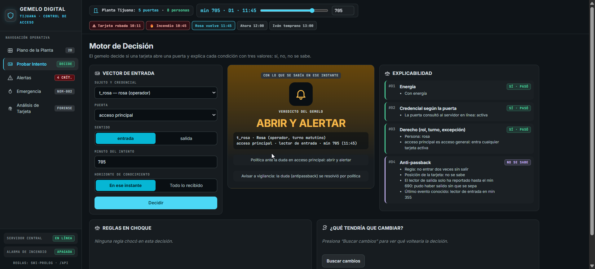

### Situación 3 — La tarjeta robada que ya abrió tres puertas

**La historia:** Marta reporta su tarjeta a las 10:00 y el servidor la revoca a las 10:01. El servidor se cae de 10:03 a 10:33. El ladrón usa la tarjeta en tres puertas en un minuto.

**Qué deduce el gemelo:** lo que sabe el servidor frente a lo que sabe cada puerta según su última sincronización.
- **Acceso principal, línea y almacén** todavía aceptan la tarjeta. **Oficinas no**, porque se sincronizó a las 10:02.
- Los tres usos son **incompatibles con una sola persona**: dos puertas en el mismo minuto, cuando caminar entre ellas toma 2 o 3 minutos.
- Separa los usos de Marta (antes del reporte) de los del ladrón.
- **Hipótesis:** si el reporte llega a las 9:55, los tres usos se niegan. Si llega a las 10:05, no cambia nada: reportar no basta si la puerta no se entera.

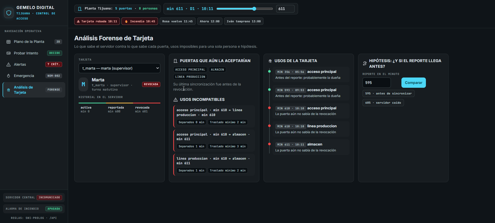

### Situación 4 — Fuego, sin luz y una tarjeta revocada adentro

**La historia:** a las 10:40 suena la alarma y se va la energía. Las puertas **fail-secure** quedan cerradas, las **fail-safe** abiertas, y la **salida de emergencia abre siempre** (NOM-002-STPS-2010). El portador de la tarjeta revocada está en el almacén.

**Qué deduce el gemelo:** dónde está cada persona, cómo queda cada puerta, la ruta de salida de cada quien (o el aviso de que no tiene), qué regla gana y a quién se le falla.
- Luis y el portador salen por la **salida de emergencia del almacén**. Aquí chocan dos reglas: *«la salida de emergencia abre siempre»* contra *«una tarjeta revocada no abre»*. **Gana la vida**, se le falla a seguridad patrimonial, y el hecho se registra y se alerta.
- La entrada del almacén **sigue cerrada**.
- **Beto, Jorge, Rosa y el visitante quedan sin salida** (ver [hallazgos](#12-hallazgos-del-gemelo)), y el gemelo avisa a vigilancia para liberar una salida a mano.

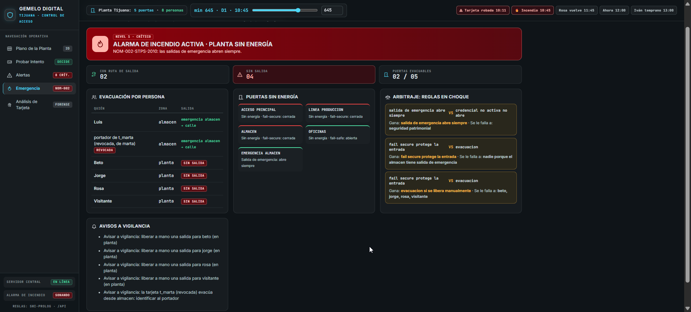

### Situación 5 — La puerta que se abrió y nadie la abrió

**La historia:** la puerta del almacén tiene lector, sensor de contacto y contador de paso. Ninguno dice «forzada»: el gemelo lo deduce cruzando las tres señales con las órdenes de trabajo.

| Hora | Señales | Veredicto | Aviso |
|---|---|---|---|
| 07:30 | Se abre sin tarjeta, pero Jorge tiene orden de trabajo | Apertura con excepción | Solo registro |
| 08:20 | Se abre sin acceso ni excepción | **Forzada** | Despertar al vigilante |
| 08:40 | Un acceso y el contador marca 2 | **Tailgating** | Alerta a vigilancia |
| 09:00 | Acceso normal, pero queda abierta 8 min (límite 3) | **Abierta de más** | Alerta a vigilancia |

El sensor de la línea de producción mandó un valor imposible (7): su estado es **no se sabe**, no «cerrada», y **no** dispara una falsa alarma.

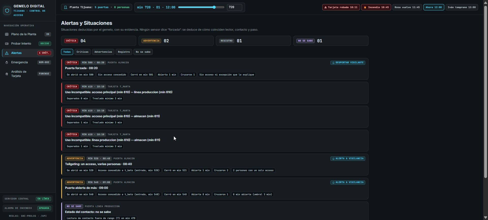

## 7. Las cinco preguntas con las mismas reglas

El enunciado pide que estas cinco preguntas salgan de **las mismas reglas**, sin un predicado por pregunta:

```prolog
% 1. Decisión: ¿puede pasar?
?- decide(intento(t_ivan, linea_produccion, entrada, 780), D, E).
D = abrir.

% 2. Explicación: ¿por qué se negó?
?- decide(intento(t_luis, acceso_principal, entrada, 620), negar, E).
E = [..., c(antipassback, no, [regla(no_entrar_dos_veces_sin_salir), posicion(dentro), ...])].

% 3. Todas las respuestas: ¿quién está en el almacén?
?- situacion(Q, dentro(almacen), _).
Q = persona(luis) ;
Q = portador(t_marta, revocada, de(marta)).

% 4. Al revés: ¿qué tendría que cambiar para que abra?
?- que_falta(intento(t_visit, oficinas, entrada, 600), C).
C = [cambio([agrega(excepcion(visitante, oficinas, propuesta, beto, 600, 660))], abrir),
     cambio([agrega(permiso(visitante, oficinas, todos))], abrir)].

% 5. Hipótesis: ¿y si el reporte hubiera llegado antes?
?- hipotesis_reporte(t_marta, 595, C).
C = [..., cmp(uso(610, acceso_principal), real(abrir_y_alertar), hipotesis(negar)), ...].
```

## 8. Interfaz

La interfaz tiene cinco vistas, diseñadas en **Google Stitch** (export en [`design/`](design/)) en versión de escritorio y de celular:

| Vista | Qué muestra |
|---|---|
| **Plano de la Planta** | Las 4 zonas con sus personas y puertas: energía, contacto, modo de falla, sincronización y si está desactualizada |
| **Probar Intento** | Formulario del intento, veredicto con color, explicabilidad (cada condición con sí, no o no se sabe), reglas en choque y «¿qué tendría que cambiar?» |
| **Alertas** | Situaciones deducidas, ordenadas por severidad, con su evidencia y a quién avisar |
| **Emergencia** | Banner de alarma, ruta de evacuación por persona, puertas sin energía, arbitraje y avisos |
| **Análisis de Tarjeta** | Historial de la credencial, puertas expuestas, usos clasificados e incompatibles, y comparador de hipótesis |

Arriba hay un **reloj del escenario** (slider y minuto) y botones que llevan directo a cada situación: *Tarjeta robada 10:11*, *Incendio 10:45*, *Rosa vuelve 11:45*, *Ahora 12:00* e *Iván temprano 13:00*. Los colores siempre significan lo mismo: verde sí, rojo no, ámbar alerta y **violeta no se sabe**.

La interfaz no usa frameworks ni CDN, así que funciona sin internet.

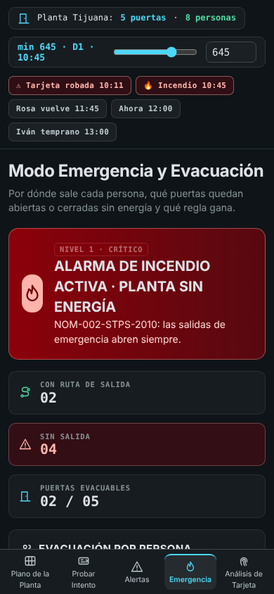

## 9. API

| Ruta | Parámetros | Respuesta |
|---|---|---|
| `GET /api/catalogo` | — | Tarjetas, puertas y lectores |
| `GET /api/estado` | `t` | Puertas, personas con su zona y número de alertas críticas |
| `GET /api/dentro` | `t`, `zona` | Quién está dentro |
| `GET /api/decide` | `tarjeta`, `puerta`, `lector`, `t`, `modo` (`tiempo_real`/`auditoria`) | Decisión, condiciones, notas y choques |
| `GET /api/que_falta` | `tarjeta`, `puerta`, `lector`, `t` | Cambios que voltean la decisión |
| `GET /api/alertas` | `t` | Situaciones con severidad, aviso y evidencia |
| `GET /api/emergencia` | `t` | Rutas, puertas, choques y avisos |
| `GET /api/tarjeta` | `tarjeta`, `t`, `reporte` | Historial, puertas expuestas, usos e hipótesis |

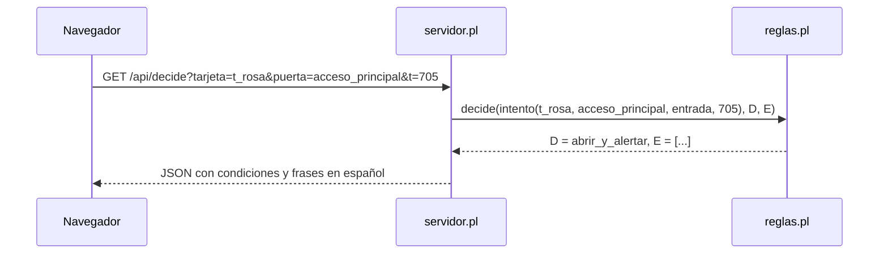

## 10. Pruebas

Son **40 pruebas plunit** en seis grupos, uno por situación más uno para las cinco preguntas:

| Grupo | Qué comprueba | Pruebas |
|---|---|---|
| `s1_derecho_vigente` | Turno, excepción vigente, vencida o sin facultad, visitante y consulta inversa | 9 |
| `s2_orden_de_eventos` | Lector atrasado, auditoría, reuso de tarjeta, orden incierto, quién está dentro | 6 |
| `s3_tarjeta_robada` | Servidor contra puerta, puertas expuestas, usos incompatibles, hipótesis | 8 |
| `s4_emergencia` | Ruta o aviso para cada persona, salida de emergencia, entrada protegida, a quién se le falla | 5 |
| `s5_puerta_anomala` | Cuatro veredictos distintos, a quién despertar, sensor no creíble | 6 |
| `c6_cinco_preguntas` | Las cinco preguntas con las mismas reglas; las hipótesis no dejan rastro | 6 |

```text
% All 40 tests passed
```

Probado en Windows con SWI-Prolog 11.0.1 y en Linux con 9.0.4.

## 11. Supuestos

| Supuesto | Valor |
|---|---|
| Tiempo | Minuto 0 = 00:00 del día 1; `ahora(720)` = 12:00 |
| Turnos | Matutino 06:00–14:00 · Vespertino 14:00–22:00 · Nocturno 22:00–06:00; tolerancia de 15 min antes |
| Acceso principal | Acceso general: entra cualquier tarjeta activa; el turno se controla en línea, almacén y oficinas |
| Horario de oficinas | 08:00–18:00 |
| Quién da excepciones | Supervisora (planta, almacén) · Vigilancia (planta, almacén, oficinas) |
| Desfase entre relojes de lectores | 2 min |
| Puerta abierta de más | Más de 3 min |
| Política ante la duda | Acceso principal: abrir y alertar · Demás puertas: negar y alertar |
| Sin servidor | La puerta decide con la copia de su última sincronización |
| Sin energía | Fail-secure cerrada · Fail-safe abierta · Salida de emergencia abre siempre |
| Distancias entre puertas | Inventadas para el escenario (`traslado/3`) |

El detalle está en [`gemelo/README.md`](gemelo/README.md).

## 12. Hallazgos del gemelo

1. **La planta tiene un error de diseño.** Con el acceso principal en modo fail-secure, un corte de energía deja **sin salida** a quienes están en la planta. Nadie lo pidió: el gemelo lo dedujo al combinar el modo de falla, la energía y el grafo de puertas. Recomendación: barra de pánico o salida de emergencia en la planta.
2. **Reportar una tarjeta no basta.** Si la revocación ocurre con el servidor caído, ninguna puerta se entera. La hipótesis del reporte a las 10:05 lo demuestra.
3. **«No se sabe» es una respuesta válida.** Un sistema tradicional habría dejado a Rosa atrapada afuera o habría despertado al vigilante por un sensor descompuesto.

## 13. Erlang y Prolog: qué va en cada lado

En **Erlang/OTP** se resuelve lo que **pasa**: muchas puertas concurrentes que deciden en menos de un segundo, siguen funcionando aunque se caiga el servidor y se reinician bajo supervisión, más una bitácora que no pierde eventos bajo carga. Es un problema de concurrencia, tolerancia a fallas y tiempo real.

En **Prolog** se resuelve lo que **debía pasar y por qué**: deducir el permiso, explicar cada decisión, distinguir «no salió» de «no me enteré», razonar con lo que sabe cada puerta frente al servidor y desempatar reglas válidas que chocan. Todo eso se responde con las mismas reglas: la decisión, la explicación, todas las respuestas, la pregunta al revés y la hipótesis.

Erlang no es bueno para deducir y justificar, y Prolog no es bueno para atender 150 lecturas por minuto con procesos que se caen. Por eso cada cosa va en su lugar.

## 14. Lo que se logró

| Criterio de aceptación (`CONTEXTO_AGENTES.md`) | Estado |
|---|---|
| 1. Derecho vigente: misma tarjeta abre en su turno y se niega fuera; la excepción válida cambia el resultado; la vencida o sin facultad no; consulta inversa | ✅ |
| 2. Orden de eventos: ordena por reloj del lector; distingue a quien salió de quien reutiliza; orden incierto da «no se sabe» con política declarada | ✅ |
| 3. Revocación: lista las puertas que aún aceptan la tarjeta y los usos incompatibles; la hipótesis del reporte cambia la respuesta | ✅ |
| 4. Emergencia: ruta o aviso para cada persona; salida de emergencia abre con tarjeta revocada y alerta; entrada protegida cerrada; nombra el choque y a quién se le falla | ✅ |
| 5. Puerta anómala: cuatro veredictos distintos; sin contacto → «no se sabe», sin falsa alarma | ✅ |
| 6. Las cinco preguntas con las mismas reglas | ✅ |

| Entregable | Estado |
|---|---|
| Gemelo en SWI-Prolog (`hechos.pl`, `reglas.pl`, `servidor.pl`) | ✅ |
| Pruebas plunit, al menos una por situación | ✅ 40 pruebas |
| Interfaz diseñada en Google Stitch, servida desde Prolog, sin reglas | ✅ |
| Lista de supuestos y cifras | ✅ |
| Párrafo Erlang / Prolog | ✅ |

**En números:** 155 hechos · 87 reglas · 5 situaciones · 40 pruebas · 8 endpoints · 5 vistas.

## 15. Tecnologías

| Tecnología | Uso |
|---|---|
| SWI-Prolog 11 | Hechos, reglas, explicaciones y servidor web |
| plunit | Pruebas unitarias |
| `library(http/...)` | Servidor HTTP y respuestas JSON |
| `library(aggregate)`, `lists`, `apply`, `occurs` | Agregados, listas y recorrido de términos |
| HTML, CSS y JavaScript | Interfaz sin frameworks (solo `fetch` a la API) |
| Google Stitch | Diseño de la interfaz |
| Mermaid | Diagramas de este README |

## 16. Incidencias durante el desarrollo

| Incidencia | Solución |
|---|---|
| PowerShell no reconocía `swipl` | SWI-Prolog estaba instalado pero no en el PATH; se usó la ruta completa `C:\Program Files\swipl\bin\swipl.exe` |
| Ruta no encontrada al descomprimir | «Extraer todo» crea una carpeta extra; se localizó con `Get-ChildItem ~ -Recurse -Filter servidor.pl` |
| La interfaz mostraba «UNDEFINED CRÍT.» y «Cargando…» | Seguía corriendo el servidor viejo; se detuvo con `halt.`, se reinició y se recargó con Ctrl+F5 |
| Stitch inventó datos que no existen en el modelo | La interfaz final solo muestra lo que responde `/api` |
| La biblioteca de archivos estáticos no servía `web/` con la ruta por defecto | Se escribió un manejador propio (`servir_web/1`) que además impide salir de `web/` |

## 17. Referencias

- [SWI-Prolog — Manual de referencia](https://www.swi-prolog.org/pldoc/doc_for?object=manual)
- [plunit — Pruebas unitarias en SWI-Prolog](https://www.swi-prolog.org/pldoc/doc_for?object=section(%27packages/plunit.html%27))
- [Bibliotecas HTTP de SWI-Prolog](https://www.swi-prolog.org/pldoc/doc_for?object=section(%27packages/http.html%27))
- NOM-002-STPS-2010, prevención y protección contra incendios en los centros de trabajo — [Diario Oficial de la Federación](https://www.dof.gob.mx)
- [Repositorio de la clase: tectijuana/logicfun-proyectos](https://github.com/tectijuana/logicfun-proyectos)
- [Google Stitch](https://stitch.withgoogle.com)
